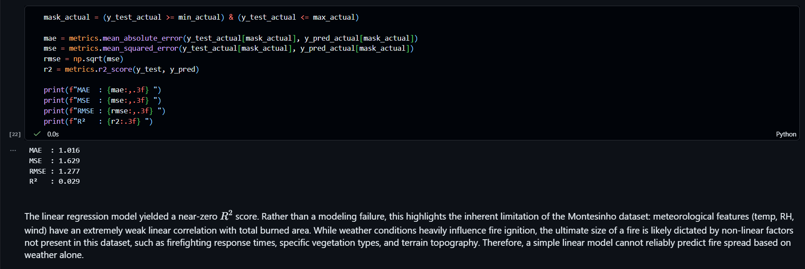

# Forest-fire-detection

Predicts how large an area a forest fire will spread, based on wind speed, temperature, humidity, and the ISI fire index (pandas, matplotlib, scikit-learn).
  


## Team and roles

| Member | Entry no. | GitHub | Role |
| --- | --- | --- | --- |
| BLESS SINGH KUKREJA | 2026DAB1291 | [Bless-Kukreja](https://github.com/Bless-Kukreja) | Execution lead |
| NANABOLU BHAVISHYA REDDY | 2026MCB1548 | [Bhavishya-reddy275](https://github.com/Bhavishya-reddy275) | PPT lead |
| KESHAV MISHRA | 2026AIB1050 | [keshavmishra-dot](https://github.com/keshavmishra-dot) | Video lead |
| SAKSHAM PATHAK | 2025EEB1376 | [Saksham-Pathak](https://github.com/Saksham-Pathak) | Documentation lead |

All four members contributed code (see commit history).

## Project structure
 
```
Forest-fire-detection/
├── Datasets/
│   └── survey.csv         # 517 rows x 13 columns (UCI Forest Fires data, via Kaggle)
├── graphs/
│   ├── Output.png
│   ├── RH_vs_burned_area.png
│   ├── actual_vs_predicted_plot.png
│   └── temperature_vs_burned_area.png
├── src/
│   └── main.ipynb         # entry point: preprocessing, training, evaluation
├── requirements.txt       # pinned library versions
├── .gitignore
├── AI Mini Project PPT.pdf
└── README.md
```
 
## Setup
 
Tested on Python 3.12 and 3.13 (Ubuntu 24.04). 
 
```bash
git clone https://github.com/Bless-Kukreja/Forest-fire-detection.git
```
```
cd Forest-fire-detection
```
```
python -m venv venv
```
Windows:
```
venv\Scripts\activate
```
Linux/Mac: 
```
source venv/bin/activate
```
```
pip install -r requirements.txt
```
 
## How to run
 
1. `cd src`
2. `jupyter notebook main.ipynb`, then choose **Kernel -> Restart and Run All** (in VS Code: open `src/main.ipynb` and click **Run All**).
3. If an HTML file is requested to be opened, open it and click on the localhost link in it to get to the actual notebook. Then choose your kernel, and under Run, select Run All Cells.
4. The notebook prints MAE, MSE, RMSE, and R-squared on the test set and shows the plots.
5. Expected runtime: about 12 seconds

Result: MAE 1.016, MSE 1.629, RMSE 1.277, R² 0.029. The linear regression model yielded a near-zero R² score, so weather alone cannot reliably predict fire size.

## Expected output



## Links
 
[AI Mini Project PPT](https://github.com/Bless-Kukreja/Forest-fire-detection/blob/main/AI%20Mini%20Project%20PPT.pdf)
Video: [FILL: unlisted YouTube or Drive link]
 
## AI-use disclosure
 
- Claude: first draft of this README and a final consistency check of the repo; reviewed and edited by Saksham.
- Gemini: Figured out how to use the highly skewed data by applying a log(1+x) transform.
- ChatGPT: Used for organizing project content.
- No AI was used to generate the dataset or corresponding results.
 
